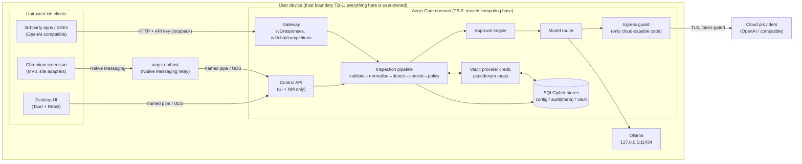
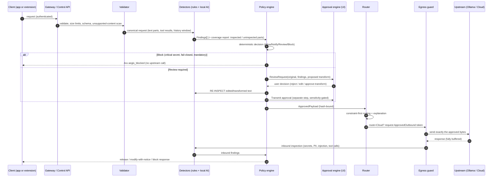
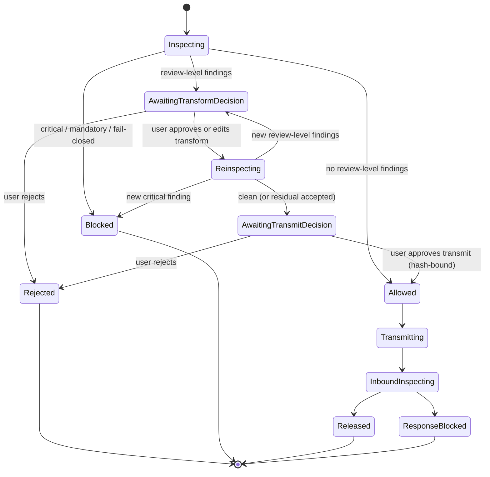
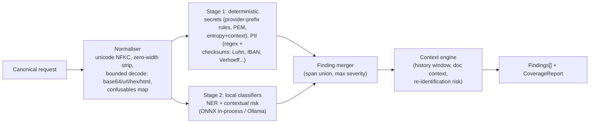

# Aegis AI Firewall — System Architecture (v0.1, for review)

Status: **Draft for PM / UX / security review. No production code exists yet.**
Repository state: greenfield (confirmed by product owner). Everything below lives under `aegis/`.

---

## 1. Architectural thesis

Aegis is **not a proxy with a PII filter**. It is a **local enforcement kernel** (the *Aegis Core daemon*) that every AI-bound byte must pass through, with three properties that are enforced by construction rather than by convention:

1. **Single enforcement point.** Gateway, browser extension, and desktop UI are *clients* of one daemon. Only the daemon holds policy, provider credentials, the pseudonym vault, and network egress to cloud providers.
2. **Capability-gated egress.** The only code that can open a connection to a cloud provider requires an `ApprovedOutbound` token that only the Approval/Policy pipeline can mint (ADR-0006). "No silent cloud fallback" and "only approved sanitised content reaches cloud" become *type-system* facts, not code-review hopes.
3. **Deterministic core, advisory AI.** Policy decisions are a pure, deterministic function of findings. Local AI classifiers may *add* findings or *raise* severity; they can never remove a deterministic finding or relax a mandatory rule (ADR-0005).

### Security invariants (testable; each maps to an acceptance test, see §12)

| # | Invariant |
|---|---|
| I1 | No payload leaves the machine to a cloud provider without an `ApprovedOutbound` token bound to the exact bytes sent (hash-bound). |
| I2 | A request routed LOCAL ONLY can never produce an egress token; the cloud client is not constructible in that code path. |
| I3 | Critical secrets (API keys, private keys, passwords) are blocked by a mandatory rule no profile/user setting can disable. |
| I4 | Transform approval ≠ transmit approval; edited transformed text is re-inspected from scratch. |
| I5 | Every response is fully buffered and inspected before any byte reaches the client (gateway/Tier-A/B paths). |
| I6 | Persistent storage never contains prompt/response text, plaintext mappings, or credentials; audit schema has no free-text columns. |
| I7 | Pseudonym mappings exist only AEAD-encrypted, locally, session-scoped with TTL; credentials are never mapped/reconstructable. |
| I8 | Content that could not be inspected is never labelled inspected/safe (explicit `uninspected` state). |
| I9 | Any inspection component failure on a path with critical-risk potential → fail closed. |
| I10 | Zero outbound connections except user-configured providers (and user-approved update fetch). |

---

## 2. System context and component view



Key point: the **UI and extension are not in the trust path for enforcement**. A compromised or buggy UI can approve things the user could approve anyway, but it cannot bypass mandatory policy, read provider credentials, or reach the network.

---

## 3. Module map (the 23 proposed modules → crates/packages)

Rust workspace unless stated. "P" = priority tier from the brief.

| # | Module | Crate / package | Process | P | Depends on (interfaces only) |
|---|---|---|---|---|---|
| 1 | Desktop application | `apps/desktop` (Tauri shell + React/TS) | UI | P1 | Control API client |
| 2 | Chromium extension | `apps/extension` (TS, MV3) | Browser | P0 | NM protocol |
| 3 | Native Messaging bridge | `crates/aegis-nmhost` | tiny relay binary | P0 | `aegis-ipc` |
| 4 | Local API gateway | `crates/aegis-gateway` (axum) | daemon | P0 | `aegis-core`, pipeline trait |
| 5 | Request validation | `crates/aegis-validate` | daemon | P0 | `aegis-core` |
| 6 | Policy engine | `crates/aegis-policy` | daemon | P0 | `aegis-core` only |
| 7 | PII detection engine | `crates/aegis-detect-pii` | daemon | P0 | `Detector` trait |
| 8 | Secret scanner | `crates/aegis-detect-secrets` | daemon | P0 | `Detector` trait |
| 9 | Prompt-injection detection | `crates/aegis-detect-injection` | daemon | P0 (basic) / P1 | `Detector` trait |
| 10 | Context intelligence engine | `crates/aegis-context` | daemon | P1 | `Classifier` trait |
| 11 | Decontextualisation engine | `crates/aegis-transform` | daemon | P1 | context, vault |
| 12 | Encrypted reconstruction vault | `crates/aegis-vault` | daemon | P0 | `aegis-crypto`, `aegis-store` |
| 13 | Profile manager | `crates/aegis-profiles` | daemon | P1 (Personal profile P0) | policy |
| 14 | Approval engine | `crates/aegis-approval` | daemon | P0 | policy, control API |
| 15 | Token optimiser | `crates/aegis-tokenopt` | daemon | P2 | transform output only |
| 16 | Model router | `crates/aegis-router` | daemon | P1 (static route P0) | provider registry |
| 17 | Ollama adapter | `crates/aegis-provider-ollama` | daemon | P1 | `Provider` trait |
| 18 | OpenAI adapter | `crates/aegis-provider-openai` | daemon | P1 | `Provider`, egress |
| 19 | OpenAI-compatible adapter | `crates/aegis-provider-compat` | daemon | P1 | `Provider`, egress |
| 20 | Tool-call inspector | `crates/aegis-toolguard` | daemon | P1 | policy |
| 21 | Response inspector | `crates/aegis-inspect-response` | daemon | P0 | detectors, policy |
| 22 | Metadata-only audit | `crates/aegis-audit` | daemon | P0 | `aegis-store` |
| 23 | Update manager | `crates/aegis-update` | daemon | P2 | egress (update-class only) |

Added (not in the brief's list, but needed):

| Module | Crate | Why |
|---|---|---|
| Canonical schema | `crates/aegis-core` | Shared types; zero deps on I/O; generates TS types. |
| Egress guard | `crates/aegis-egress` | The *only* crate with an outbound HTTP client; mints/validates `ApprovedOutbound`. |
| Platform layer | `crates/aegis-platform` | DPAPI / Keychain / Secret Service, OS peer identity, autostart, NM registration. |
| Crypto | `crates/aegis-crypto` | KDF, AEAD, key hierarchy; audited, minimal API. |
| Storage | `crates/aegis-store` | SQLCipher access, migrations, typed repositories. |
| IPC | `crates/aegis-ipc` | Framed, authenticated local transport (named pipe / UDS). |
| Daemon | `crates/aegis-daemon` | Composition root; wires everything; owns lifecycle. |
| Test kit | `crates/aegis-testkit` | Mock providers, network-deny harness, adversarial corpora. |

**Coupling rules** (enforced by `cargo deny` / a dependency-graph lint in CI):
- `aegis-policy` depends only on `aegis-core`. No I/O, no AI, no network, no clock except injected.
- `aegis-detect-*` and `aegis-context` never depend on `aegis-egress` or any provider crate.
- Provider crates never depend on `aegis-policy`; they receive already-approved canonical requests.
- Only `aegis-egress` depends on an HTTP client with non-loopback capability (Ollama adapter uses a loopback-only client type).
- UI/extension depend only on generated protocol types, never on policy logic.

---

## 4. Request lifecycle (outbound)



Notes:
- Steps for LOCAL routes are identical except the router selects Ollama and the egress guard is never asked for a token.
- For API clients the HTTP request is **held open** during review. Gateway sends SSE keep-alive comments (no content) for streaming clients and returns `408 aegis_approval_timeout` after a configurable timeout. Per-API-key policy may choose `on_review: block` (non-interactive automation) instead of waiting.
- The *whole-prompt* is inspected, not just the latest message: conversation history in the request, tool results, and system prompt are all in scope (they are what is transmitted).

### Review/approval state machine (ADR-0008)



Transmit approval is *sensitivity-gated*: Low → notify-only; Medium → one-click; High → explicit confirm showing exact final bytes; Critical → not approvable if the finding is on the mandatory-block list.

---

## 5. Inbound inspection, streaming, tool calls

**Responses** (ADR-0007): the gateway always requests a *non-streaming or fully-collected* upstream response, inspects it, then — if the client asked for `stream: true` — replays it as synthetic SSE chunks in the client's expected event format. Trade-off: time-to-first-token = full generation time. Mitigation: keep-alive comments; local models make this cheap; documented honestly in UI ("Aegis protection adds latency in streaming mode").

**Tool calls** (ADR-0013):
- Aegis does not execute tools; the client does. Aegis inspects (a) `tool_calls`/`function_call` arguments in responses before release, and (b) tool *results* arriving as messages in the next request (outbound path, treated as untrusted retrieved content).
- Risk classes for tool calls come from the policy (shell exec, file write/delete, network egress, payments, email/send). Risky → held pending user approval; the client sees a blocked/stripped response with a machine-readable reason.
- **Server-side tools** (Responses API built-ins such as web search / code interpreter / file search, MCP connectors executed by the provider) cannot be inspected → **blocked by default** with `aegis_unsupported_server_tool`.
- **Server-side state** (`previous_response_id`, `store: true`, `conversation`) means the provider holds history Aegis never saw → default: force/require `store: false` and reject `previous_response_id`; Aegis maintains conversation context locally.

**Prompt injection**: retrieved content / tool results / documents are tagged `provenance = untrusted` in the canonical schema. Injection detectors produce findings; but *the real defence is structural*: untrusted content can never alter policy, approvals, routing mode, or vault behaviour because those inputs come only from the authenticated control plane, never from model text. Injection findings in untrusted content raise sensitivity and flag tool calls that follow them.

---

## 6. Detection architecture



- **Stage 1 is mandatory and always runs** (microseconds–ms). It alone is sufficient to enforce I3 (critical secret blocking), so acceptance criterion 1 does not depend on any model being available.
- **Stage 2 is monotonic**: it can add findings or increase severity of a span; the merger takes max severity per span. It cannot delete or downgrade Stage 1 findings (ADR-0005).
- **Stage 2 unavailable** (model missing, Ollama down, timeout) → `CoverageReport` marks contextual inspection as `unavailable`; policy then applies risk-based fail-closed: profiles/rules define which categories require Stage 2 coverage for cloud transmission (default: cloud transmission blocked if Stage 2 unavailable *and* the content has any Stage 1 finding ≥ Medium or the profile requires contextual coverage; otherwise proceed with explicit "contextual check skipped" notice). Exact defaults flagged as OPEN-04.
- **Categories** (taxonomy v1): `identity`, `credential_secret`, `financial`, `confidential`, `technical`, `personal_record`, `contextual_identity`, `defence`. Every finding carries `{category, subtype, span, severity, confidence, detector_id, rule_version}`.
- **Defence/military**: *subject matter is not a severity driver.* Severity is raised only by markers: classification/handling markings (e.g. "SECRET", "NOFORN", national equivalents), precise operational specifics (unit identifiers + locations + times), grid references + unit IDs, named-operation details, etc. A prompt that merely discusses doctrine or history yields at most an informational `defence` tag. Marker lexicons are data, versioned, user-extendable.
- **Detectors are data-driven where possible** (rule packs, versioned, signed with the app update) so rule updates don't require code changes. Regional ID formats (e.g. Aadhaar/Verhoeff, PAN, SSN, NI number) ship as optional rule packs.
- **Performance budget (target)**: Stage 1 p95 < 20 ms for 32 KB text; Stage 2 budgeted separately (hundreds of ms on CPU; run in parallel with Stage 1 when the profile requires it).

---

## 7. Policy engine

- **Pure function**: `decide(PolicyInput) -> Decision`. Inputs: findings, coverage report, request metadata (client, mode, route candidates, direction, provenance), effective policy. Outputs: `{action, required_approvals[], reasons[] (codes), transform_plan?}`.
- **Action lattice**: `Allow < Notify < Review < Block`. Combination is `max`. A rule can only move *up* the lattice relative to defaults, except explicit user-owned allowances for non-mandatory rules.
- **Policy layering** (ADR-0017): `Mandatory global` (compiled-in defaults + signed rule pack; immutable at runtime) → `Profile` (versioned; may tighten, or relax only rules flagged `profile_relaxable`) → `Client/integration override` (can only tighten) → `Per-request user decision` (approvals; cannot touch mandatory rules).
- **Mandatory block list (v1)**: private keys, provider API keys/tokens, passwords/credentials in clear, session cookies/bearer tokens, DB connection strings with credentials, seed phrases.
- **Policy is data + tests**: expressed as a typed Rust structure loaded from versioned files; table-driven golden tests; property tests assert monotonicity (adding a finding never lowers the action).
- **Determinism**: no randomness, no wall-clock, no network, no AI inside `decide`.

---

## 8. Context intelligence, transforms, vault

- **Context window** per conversation: current prompt + prior turns in the request + documents pasted/attached as text. Aegis keeps *no plaintext conversation store*; for the extension path it uses a per-session in-memory context (zeroised on end) plus encrypted pseudonym maps.
- **Transform kinds**: `anonymise` (irreversible removal/generalisation), `pseudonymise` (stable placeholders like `[PERSON_1]`, reversible locally), `decontextualise` (generalise identifying context: "the CFO of Acme in Pune" → "a senior finance executive at a mid-sized company"), `local_only` (span withheld; never leaves device).
- **Meaning-preservation guard**: transforms are produced by deterministic substitution + (optionally) local-model rewrite. A **preservation checker** asserts that numbers, dates, negations, quantifiers, and exception clauses in the original appear unchanged in the transformed output (token-diff constraint) and flags violations in the Review UI. Local-model rewrites are *proposals*; they pass through reinspection like user edits.
- **Reconstruction**: when an approved response contains placeholders, the daemon (not the cloud) substitutes the originals locally before returning to the client. Mapping scope = conversation/session, TTL default 24 h, AEAD-encrypted (ADR-0009, ADR-0014). **Credential-class spans are never pseudonymised or reconstructable** — they are blocked or removed.
- **Round-trip caveat**: if a cloud model rewrites a placeholder (`[PERSON_1]` → "Person One"), reconstruction is best-effort; unreconstructed placeholders are shown as such, never guessed.

---

## 9. Router and egress guard

- **Constraint-first routing** (ADR-0018): candidates = providers matching hard constraints (operating mode, consent granted, provider's max sensitivity ceiling, capability: tools/structured output/context length, health) → rank by profile preference (privacy > quality > cost/latency) → emit `RouteDecision{chosen, rejected[{provider, reason_code}], explanation}` shown to the user.
- **Modes**: `LOCAL_ONLY` → candidate set = local providers only; `ONLINE_ONLY` → cloud only; `HYBRID` → local for sensitive, cloud for sanitised/low-risk, user-defined split; `AUTO` → router decides per request using sensitivity + capability + availability, always explaining.
- **No silent fallback**: if the chosen provider fails, the router returns `FallbackProposal` to the user/profile policy. Falling from local to cloud is *never automatic*: it requires a fresh, explicit approval (and re-runs the transmit approval for the cloud-bound content). In `LOCAL_ONLY` the proposal set is empty by construction.
- **Egress guard** (`aegis-egress`): exposes `send(ApprovedOutbound, ProviderEndpoint) -> RawResponse`. `ApprovedOutbound{request_id, payload_sha256, provider_id, expires_at, nonce}` is created only by `aegis-approval` via a `pub(crate)` constructor behind a sealed trait, then validated against the actual bytes at send-time. Cloud-consent-per-provider is checked here too (first-use consent record).
- Update-class fetches use a separate `UpdateRequest` token type with a pinned host allowlist.

---

## 10. Storage and cryptography (ADR-0009)

Three SQLite files, three trust levels:

| File | Contents | Encryption | Notes |
|---|---|---|---|
| `config.db` | profiles, policies, provider metadata, consent records, client registry (hashed API keys) | SQLCipher, key from KEK | no secrets in plaintext |
| `vault.db` | provider credentials; pseudonym maps | SQLCipher + **field-level XChaCha20-Poly1305** with per-session DEKs | maps have TTL + secure-delete sweep |
| `audit.db` | metadata-only events | SQLCipher (integrity-focused) | **schema has only enums, ints, hashes, timestamps — no free-text/`TEXT` columns beyond fixed codes** |

Key hierarchy: `OS secret (DPAPI / Keychain / Secret Service)` → unwraps `Root Key`; optional `master password` → Argon2id → second KEK wrapping the Root Key (*both* required if enabled). `Root Key` wraps DB keys and the vault DEK-wrapping key. Key rotation and lock/unlock states are explicit (`Locked` daemon serves **block-all** with `aegis_locked` for anything needing the vault).

Audit-by-construction: the audit API accepts only a typed `AuditEvent` enum; there is no function taking a string payload. Static test greps the store crate for `TEXT` columns outside an allowlist; runtime test fuzzes prompts and scans all DB files + logs for canary strings (acceptance #12).

Process logs: structured, field-allowlisted; `tracing` layer drops any field not marked `Loggable`. Core dumps disabled; sensitive buffers use `zeroize`.

---

## 11. Process model & repository layout (summary; see 05-deployment.md)

- **Per-user background process** `aegis-daemon` (ADR-0003), auto-started at login (Windows Task Scheduler/Run key, macOS LaunchAgent, Linux systemd `--user` unit/autostart). Tauri app is a separate process that talks to the daemon; closing the UI does not stop protection.
- **Repo**: Cargo workspace + pnpm workspace in one monorepo.

```
aegis/
├─ Cargo.toml                 # workspace
├─ pnpm-workspace.yaml
├─ crates/                    # see §3
├─ apps/
│  ├─ desktop/                # Tauri (src-tauri thin) + React/TS UI
│  └─ extension/              # MV3 extension + site adapters
├─ packages/
│  ├─ protocol/               # generated TS types (from aegis-core via schemars/ts-rs)
│  ├─ ui/                     # design-system components (tokens, Lucide)
│  └─ adapters/               # site adapter SDK + per-site adapters
├─ rules/                     # signed rule packs: secrets, pii, defence markers
├─ policies/                  # mandatory global + default profiles (data)
├─ tests/
│  ├─ acceptance/             # the 16 criteria as executable e2e tests
│  ├─ corpora/                # synthetic PII/secret/injection corpora (no real data)
│  └─ adversarial/
├─ design/                    # master design system + page overrides (UX track)
└─ docs/{architecture,adr,security}
```

---

## 12. Acceptance criteria → mechanism → test

| # | Criterion | Mechanism | Primary test |
|---|---|---|---|
| 1 | API key blocked pre-transmission | Stage-1 secret scanner + mandatory block rule; I3 | Gateway e2e: mock cloud asserts 0 requests |
| 2 | Sensitive PII detected | Stage-1 + Stage-2; labelled corpus | Precision/recall gates per category in CI |
| 3 | High-risk requires review | Policy action `Review` → approval engine | e2e: request held until decision |
| 4 | Rejection prevents transmission | State machine → `Rejected` terminal; no token minted | e2e + mock cloud 0 requests |
| 5 | Edits reinspected | `Reinspecting` state mandatory after any edit | e2e: user inserts a key during edit → blocked |
| 6 | LOCAL ONLY: zero external inference calls | I2; cloud client unconstructible on route | Network-deny harness (netns/firewall rule) + mock |
| 7 | Ollama failure ≠ silent cloud fallback | Router `FallbackProposal` requires explicit approval | e2e: kill Ollama; assert 0 cloud calls |
| 8 | Only approved sanitised content to cloud | Hash-bound `ApprovedOutbound` | Mock cloud receives exact approved bytes; mutation test |
| 9 | Tool args/results inspected | `aegis-toolguard` on both directions | e2e with secret in tool result / arg |
| 10 | Malicious retrieved instructions can't override policy | Provenance tagging + control-plane-only policy inputs | Adversarial corpus run in CI |
| 11 | Responses fully inspected before release | Full-buffer + synthetic SSE | Test: upstream emits secret at end of stream; client sees nothing before block |
| 12 | Original prompts never in audit storage | Typed audit API, no text columns | Canary scan of DBs/logs after fuzz run |
| 13 | Mappings encrypted + local | Field-level AEAD; no egress path for vault | Scan vault.db for plaintext; egress type test |
| 14 | Critical inspection failure blocks | I9 fail-closed policy; detector timeout/panic isolation | Fault-injection tests |
| 15 | Unsupported sites show limitations | Coverage tiers (ADR-0012) surfaced in extension UI | Extension e2e on unsupported domain |
| 16 | No telemetry by default | I10; no analytics deps; CI egress allowlist | Run full suite under deny-all network; assert zero attempts |

---

## 13. Integration coverage — honesty model (ADR-0012)

| Tier | Path | Outbound | Inbound | Claim shown to user |
|---|---|---|---|---|
| A | API gateway | Enforced (block/transform/approve) | Enforced (full buffer) | "Fully protected" |
| B | Tested site adapter with main-world network interception | Enforced on submit | Enforced where adapter can hold the stream; per-adapter declaration | "Protected (adapter vX tested on date)" |
| C | Tested adapter, DOM-only | Enforced at composer submit (best-effort) | **Detect-only after render** | "Outbound protected; responses are checked after display" |
| D | Unsupported site | None (optional: paste/typing warning only if user enables generic mode) | None | "Not protected" — visible, persistent indicator |

Each adapter declares a machine-readable capability manifest (`outbound: enforce|advisory`, `inbound: enforce|detect`, `uploads: unsupported`) that the UI renders verbatim. Adapters are tested against recorded DOM/network fixtures and a nightly live canary; a failing canary downgrades the tier automatically and shows the user why.
