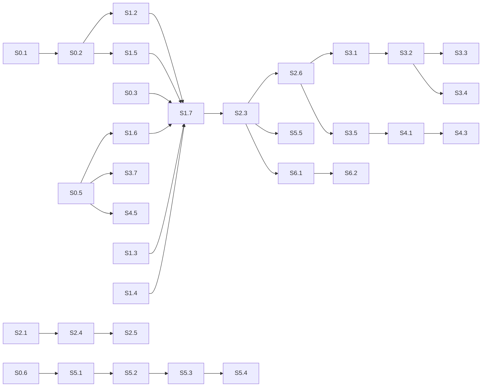

# Aegis — Prioritised Implementation Backlog (v0.1)

Sequencing principle: **thinnest end-to-end security boundary first**, then widen. Each milestone ends with a demonstrable, tested slice. No broad implementation before this document and the architecture are reviewed.

## Milestones

| M | Name | Demonstrates (acceptance #) | Contents |
|---|---|---|---|
| M0 | Foundations & decisions | — | Repo, CI, crate skeleton, contracts frozen, design system started (UX) |
| M1 | **Slice 1: Gateway blocks a secret** | 1, 12 (partial), 14 (partial), 16 | `curl`/SDK → auth → validate → Stage-1 secrets → policy Block → OpenAI-shaped error; metadata audit; mock cloud sees 0 requests |
| M2 | **Slice 2: Review → transform → transmit** | 2, 3, 4, 5, 8 | PII Stage 1, policy Review, approval engine (headless test UI + CLI), reinspection, egress token, mock cloud receives only approved bytes |
| M3 | **Slice 3: Local & routing safety** | 6, 7 | Ollama adapter, modes, router constraints, network-deny harness, no-fallback tests |
| M4 | **Slice 4: Inbound, tools, injection, vault** | 9, 10, 11, 13 | Full-buffer response inspection, synthetic SSE, toolguard, provenance, vault + reconstruction |
| M5 | **Slice 5: Browser extension** | 15, + site tiers | NM relay, extension, 1–2 tested adapters, tier UI, per-OS NM install |
| M6 | Desktop dashboard & P1 breadth | UX | Review Center, Overview, Inspector, profiles, providers vault UI, analytics (local) |
| M7 | Hardening & 1.0 | all 16 in CI | Pen test, crypto review, signing, packaging, update flow, docs |

P2 (post-1.0): more adapters/browsers, token optimiser, multimodal inspection, community framework, learning suggestions, advanced analytics.

## Backlog (IDs: E=epic, S=story)

Priority = brief tier. "Dep" = prerequisites.

### M0 — Foundations

| ID | Story | P | Dep | Acceptance criteria |
|---|---|---|---|---|
| S0.1 | Monorepo scaffold (Cargo + pnpm), CI matrix Win/mac/Linux, `cargo deny`, clippy, fmt, dependency-graph rule lint | P0 | — | CI green on 3 OSes; lint fails if non-`aegis-egress` crate pulls a general HTTP client |
| S0.2 | `aegis-core` canonical schema + generated TS types + golden fixtures | P0 | S0.1 | Chat & Responses fixtures round-trip; schema versioned |
| S0.3 | `aegis-testkit`: mock cloud provider (request-counting), mock Ollama, network-deny harness, canary scanner | P0 | S0.1 | Harness can assert "zero outbound attempts" on all 3 OSes (netns/pf/WFP or in-process socket guard) |
| S0.4 | Synthetic corpora: secrets, PII (multi-region), injection, obfuscation; labelling spec | P0 | — | No real personal data; documented generation; versioned |
| S0.5 | Spike: SQLCipher + Argon2id + DPAPI/Keychain/Secret Service on 3 OSes | P0 | S0.1 | Round-trip open/close on each OS; Linux headless behaviour documented |
| S0.6 | Spike: Native Messaging relay ↔ pipe/UDS ↔ stub daemon on Chrome/Edge | P0 | S0.1 | Message round-trip; reconnection; 1 MB limit behaviour recorded |
| S0.7 | Spike: Main-world fetch/SSE interception on 1 target site (feasibility for Tier B) | P0 | S0.6 | Report: feasibility, fragility, ToS notes → informs ADR-0012 |
| S0.8 | Master design system (UI/UX track, ui-ux-pro-max method) | P0 | — | `design/MASTER.md` + page override files; tokens, a11y rules (WCAG 2.2 AA) |
| S0.9 | Resolve OPEN-01…OPEN-08 (see 06-risks-and-open-decisions) | P0 | — | PM/architect sign-off recorded in ADRs |

### M1 — Slice 1: gateway blocks a secret

| ID | Story | P | Dep | Acceptance criteria |
|---|---|---|---|---|
| S1.1 | `aegis-daemon` skeleton, config load, lifecycle, structured allow-listed logging | P0 | S0.2 | Starts/stops cleanly; log layer rejects non-`Loggable` fields |
| S1.2 | `aegis-gateway`: `/v1/chat/completions` (non-stream), auth (API key), limits, error envelope | P0 | S1.1 | Invalid key → 401; oversize → 413; schema errors → 400 upstream-shaped |
| S1.3 | `aegis-validate` + normaliser (unicode, bounded decode) | P0 | S0.2 | Fuzz target; decode depth/size bounds enforced |
| S1.4 | Secret scanner v1 (provider-prefix rules, PEM, entropy+context) | P0 | S0.4 | ≥ 99% recall on corpus for top 30 key formats; FP budget documented |
| S1.5 | `aegis-policy` v0 + mandatory block rules + property tests | P0 | S0.2 | Monotonicity property test passes; golden decision tables |
| S1.6 | Minimal metadata audit (typed events, no text) | P0 | S0.5 | Canary scan of DB + logs after fuzz = 0 hits |
| S1.7 | **E2E test: API key in prompt → blocked, mock cloud count = 0** | P0 | S1.2–1.6 | Acceptance #1 passes on 3 OSes in CI |
| S1.8 | Fail-closed on detector failure/timeouts (fault injection) | P0 | S1.4 | Injected panic/timeouts → block; acceptance #14 (outbound portion) |

### M2 — Slice 2: review → transform → transmit

| ID | Story | P | Dep | Acceptance criteria |
|---|---|---|---|---|
| S2.1 | PII detectors Stage 1 (email, phone, names via dictionary hooks, ID formats with checksums, financial: Luhn/IBAN) | P0 | S1.3 | Precision ≥ target on corpus; checksum validators unit-tested |
| S2.2 | Policy: Review action, sensitivity tiers, `ApprovalKind` | P0 | S1.5 | Table-driven tests |
| S2.3 | `aegis-approval` state machine + IPC control API + headless reviewer (CLI) | P0 | S2.2, S0.6 | All transitions covered; hash-bound transmit approval |
| S2.4 | Deterministic transform (anonymise/pseudonymise placeholders) + preservation checker | P0 | S2.1 | Numbers/dates/negations preserved in test corpus |
| S2.5 | Re-inspection of edited text | P0 | S2.3 | User inserts key during edit → Block (acceptance #5) |
| S2.6 | `aegis-egress` + `ApprovedOutbound` + mock cloud adapter | P0 | S2.3 | Post-approval mutation refused; only approved bytes arrive (acceptance #8) |
| S2.7 | Rejection path & timeouts | P0 | S2.3 | #4 passes; held request returns `approval_timeout` |
| S2.8 | Cloud first-use consent record per provider/integration | P1 | S2.6 | No egress before consent; consent revocable |

### M3 — Slice 3: local inference & routing safety

| ID | Story | P | Dep | Acceptance criteria |
|---|---|---|---|---|
| S3.1 | `Provider` trait + Ollama adapter (loopback-only client) | P1 | S2.6 | Chat completion via local model; model digest in metadata |
| S3.2 | Operating modes + router (constraint-first, explanations) | P1 | S3.1, S1.5 | Table tests; explanation strings reviewed by UX |
| S3.3 | LOCAL ONLY invariant tests under network-deny | P0 | S3.2, S0.3 | Acceptance #6 |
| S3.4 | Ollama failure → `ProposeFallback`, never auto | P0 | S3.2 | Acceptance #7 |
| S3.5 | OpenAI + OpenAI-compatible adapters (Chat + Responses wire) | P1 | S2.6 | Conformance suite vs recorded fixtures; unsupported-param errors preserved |
| S3.6 | Local classifier Stage 2 (ONNX NER) behind `Classifier` trait; coverage report | P1 | S2.1 | Monotonic merge test; unavailable → coverage flag |
| S3.7 | Provider credential vault (store/use; never exposed to clients) | P1 | S0.5 | No credential in any client-visible output |

### M4 — Slice 4: inbound, tools, injection, vault

| ID | Story | P | Dep | Acceptance criteria |
|---|---|---|---|---|
| S4.1 | Response inspector + full-buffer + synthetic SSE (both APIs) | P0 | S3.5 | #11; secret in final chunk blocks everything |
| S4.2 | Provenance tagging; injection detector v1 | P0 | S2.1 | Adversarial corpus thresholds; #10 |
| S4.3 | Tool-call inspector (args & results), risk classes, approval for risky calls | P1 | S4.1 | #9 |
| S4.4 | Unsupported content & server-side state policy (ADR-0013) | P0 | S1.2 | Images/files → block w/ code; `previous_response_id` rejected |
| S4.5 | Reconstruction vault (AEAD, TTL, crypto-shred) + local reconstruction | P0 | S0.5, S2.4 | #13; credentials never mapped |
| S4.6 | Context engine v1 (history window, decontextualisation proposals) | P1 | S3.6, S4.5 | Preservation checker passes on corpus |
| S4.7 | Streaming conformance (SSE event shapes for both APIs) | P1 | S4.1 | Official SDKs parse streams correctly |

### M5 — Slice 5: browser extension

| ID | Story | P | Dep | Acceptance criteria |
|---|---|---|---|---|
| S5.1 | `aegis-nmhost` + per-OS/per-browser installer/repair/uninstall | P0 | S0.6 | Install/uninstall verified on Chrome, Edge, Brave (Win/mac/Linux) |
| S5.2 | Extension core (MV3), NM client, fail-closed behaviour, status UI | P0 | S5.1 | Disconnected → submit blocked with message |
| S5.3 | Adapter SDK + capability manifests + tier badges | P0 | S5.2 | #15: unsupported site shows "Not protected" |
| S5.4 | First adapters (1–2 sites chosen by PM; selected from S0.7 findings) | P0 | S5.3 | Fixture tests + live canary; tier declared |
| S5.5 | Extension review flow (popup/side panel, never page DOM) | P0 | S2.3 | Transform/transmit approvals work; hash-bound `replace_text` |
| S5.6 | Inbound handling per tier (hold for B; detect-only for C) | P1 | S4.1 | Tier claims verified by tests |

### M6 — Desktop dashboard

| ID | Story | P | Dep | Acceptance criteria |
|---|---|---|---|---|
| S6.1 | Tauri shell + control API client + generated types | P1 | S2.3 | Cold start < target; no policy logic in UI |
| S6.2 | Review Center (original / risks / proposed / actual diff / approve-transform / approve-transmit) | P1 | S6.1, S0.8 | UX sign-off; a11y audit (WCAG 2.2 AA) |
| S6.3 | Overview, Security Inspector, Integrations, Settings, Model Router views | P1 | S6.1 | Per navigation spec |
| S6.4 | Profiles (Personal/Coding/Research/Business/Custom), versioning UI | P1 | S3.2, ADR-0017 | Cannot relax mandatory rules (negative tests) |
| S6.5 | Provider management + master password + lock/unlock UX | P1 | S3.7 | Locked state behaviours tested |
| S6.6 | Local analytics from metadata only | P1 | S1.6 | No content in analytics sources |

### M7 — Hardening & release

| ID | Story | P | Dep | Acceptance criteria |
|---|---|---|---|---|
| S7.1 | All 16 acceptance tests as one `tests/acceptance` suite in CI | P0 | M1–M5 | 16/16 green on 3 OSes |
| S7.2 | Fuzzing (parsers, IPC, NM framing, normaliser) | P0 | — | Continuous fuzz, no open crashes |
| S7.3 | Signing, notarisation, packaging, SBOM, reproducibility checks | P0 | — | Signed artifacts on 3 OSes |
| S7.4 | Update manager (opt-in checks, signed manifests, approval) | P1 | OPEN-02 | #16 still passes with updates off |
| S7.5 | External pen test + crypto review | P0 | M6 | No open High/Critical |
| S7.6 | User-facing honesty docs: protection coverage, limitations, provider data handling | P0 | — | Reviewed by PM/UX |

## Dependency overview

## Parallelisation (team-size dependent)

Track A (core security): S1.x → S2.x → S4.x. Track B (platform/integration): S0.5, S0.6, S0.7 → S5.x. Track C (UX): S0.8 → S6.x design, using headless approval until S6.1. Track D (evaluation): S0.4 corpora and metric gates grow alongside A.
