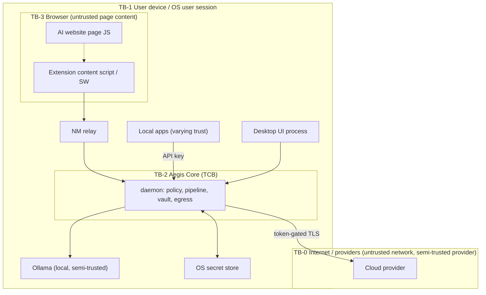

# Aegis — Security Boundaries & Threat Model (v0.1)

## 1. Assets

| ID | Asset | Why it matters |
|---|---|---|
| A1 | User prompts/responses in flight | Contain the sensitive data Aegis exists to protect |
| A2 | Provider credentials (cloud API keys) | Theft = account abuse; exposure to extension/clients forbidden |
| A3 | Pseudonym mapping vault | Re-identification of every pseudonymised prompt |
| A4 | Policy / profiles / mandatory rules | Tampering = silent weakening of protection |
| A5 | Approval decisions & integrity of "what was approved" | Approve-X-send-Y attacks |
| A6 | Audit metadata | Even metadata can reveal behaviour; integrity matters |
| A7 | Gateway client API keys | Unauthorised use of user's providers via Aegis |
| A8 | Update channel & rule packs | Supply-chain path to the TCB |

## 2. Trust boundaries

- **TB-0**: provider sees whatever is approved + metadata (IP, timing). Provider retention is out of Aegis' control → surfaced in UX consent text.
- **TB-1**: Aegis defends against *accidental* disclosure and *remote/content-borne* attackers, **not** against a fully compromised OS user account or admin/root malware (stated explicitly in docs; partially mitigated via DPAPI/Keychain/ACLs).
- **TB-2 (TCB)**: minimal code, no dynamic plugin loading in v1, detectors/rules are data, memory-safe language.
- **TB-3**: page JS is hostile by assumption (can spoof DOM, race the adapter, read what the user types before Aegis does).
- **Ollama**: loopback only; its responses are *untrusted model output*; its availability is not assumed.

## 3. Threat analysis (STRIDE-oriented, prioritised)

Severity: C=critical, H=high, M=medium.

| ID | Threat | Sev | Mitigation (architecture) | Residual risk / test |
|---|---|---|---|---|
| T1 | Secret/PII exfiltrated to cloud because detector missed it | C | Layered detection; mandatory deterministic rules; hash-bound egress; review for High; honesty about recall (published metrics) | Recall < 100% inherent. Corpus gates in CI |
| T2 | **Approve-X-send-Y** (TOCTOU between approval and send) | C | `ApprovedOutbound` bound to SHA-256 of exact bytes + provider + expiry + nonce; egress re-hashes at send | Test: mutate payload post-approval → send refused |
| T3 | Silent local→cloud fallback | C | Router returns proposals, not actions; LOCAL_ONLY has no cloud route type; egress needs token | Test #6, #7 |
| T4 | Prompt injection in retrieved content / documents / tool results alters Aegis behaviour | C | Provenance tags; policy inputs from control plane only; model text never parsed as commands by Aegis; injection findings raise sensitivity; tool call approvals | Model-level compliance with injection can't be eliminated; Aegis limits *blast radius* (tool-call gating, egress) |
| T5 | Malicious local app abuses gateway to spend user's credits / bypass | H | Per-app API keys (hashed, scoped, revocable), OS-identity binding (PID→exe path/signer, best effort), rate limits, payload limits | OS identity on loopback TCP is best-effort; same-user malware may read app config → document |
| T6 | Another local user / LAN host reaches gateway | H | Loopback default; LAN opt-in + TLS + CIDR allow-list; auth on every request; no unauthenticated endpoints except `/healthz` (no info) | — |
| T7 | Malicious web page spoofs/tampers with extension or approval UI | H | Approval UI is **never** rendered in page DOM—only in extension popup/side panel or desktop app; content script uses isolated world; page cannot call NM | Page can still lie about what the user typed (DOM-level); adapter reads from the composer at submit. Tier honesty |
| T8 | Page races adapter: sends request before interception, or via a second channel | H | Main-world fetch/XHR/WebSocket hook installed at `document_start`; adapters verify hook integrity; unsupported channel → tier downgrade | Fragile by nature (R-02); canary tests |
| T9 | Extension compromise (supply chain/store account takeover) | H | Minimal permissions (optional per-site); no credentials in extension; daemon treats extension as untrusted client (it can only *submit text for inspection / receive decisions*) | A malicious extension could skip inspection — it can't read creds or vault, but can exfiltrate page text itself → store hygiene, 2FA, reproducible builds |
| T10 | NM relay impersonation | H | Browser enforces `allowed_origins`; daemon checks relay path/signature + peer creds | Same-user malware can launch relay binary → pairing token (see deployment §4) |
| T11 | Provider credential theft from disk | H | Credentials only in `vault.db` AEAD + OS-protected root key; never sent to clients/extension; memory zeroisation | Root-level malware out of scope |
| T12 | Pseudonym vault compromise → re-identification | H | Field-level AEAD, session-scoped DEKs, TTL purge, optional master password; no plaintext mapping in logs/audit | Warm memory scraping out of scope |
| T13 | Audit log leaks content (bug or debug logging) | H | Typed audit API w/o text fields; log field allow-list; canary-scan CI test | — |
| T14 | Detector DoS / ReDoS / zip-bomb-like payload | M | Linear-time regex engine (Rust `regex`/automata), payload limits, bounded decoding depth/size, per-request CPU/time budget; timeout → fail-closed for cloud routes | Local DoS only |
| T15 | Obfuscation evasion (base64, homoglyphs, split secrets, zero-width chars) | H | Normaliser with bounded multi-decode; confusables; cross-message window joins; entropy checks; documented limits | Arbitrary encodings can't be fully covered |
| T16 | Response contains secrets/PII/malicious instructions or markdown exfil images (``) | H | Inbound inspection; strip/neutralise remote-resource links in rendered content on adapters (flag); tool-call gating | Rendering is client-side → advisory on Tier C |
| T17 | Prompt/response caching by provider / training on data | M | UX: consent text per provider; default `store:false`; send minimal content; provider-ceiling on sensitivity | Out of Aegis' control after transmission |
| T18 | Malicious update / rule pack | H | Signed manifests + pinned keys; notify-and-approve; rule packs signed separately; no auto-update | Key compromise → key rotation plan |
| T19 | Profile or UI setting used to weaken mandatory policy | H | Layered policy: schema forbids profiles from relaxing non-`profile_relaxable` rules; UI can't write mandatory layer; property tests | — |
| T20 | Side-channel via timing/size of requests | M | Out of scope v1 | Documented |
| T21 | Local classifier poisoned model file | M | Model hashes pinned in signed manifest; verify on load | Ollama-hosted models: user-chosen, verified by name+digest if provided |
| T22 | Uninspected content (images/files/audio) smuggles data | H | Unsupported parts → block-by-default on cloud routes; explicit `uninspected` label; never shown as safe (I8) | User may override per request with explicit warning (OPEN-05) |
| T23 | Responses API server-side state/tools bypass inspection | H | Reject `previous_response_id`, force `store:false`, block server-side tools | Reduces functionality (documented) |
| T24 | Denial of protection (daemon crash) used to bypass | M | Clients fail closed; watchdog; extension blocks submit when disconnected | User can disable Aegis deliberately — that's their right, shown prominently |

## 4. Fail-closed matrix (risk-based)

| Failure | LOCAL route | Cloud route, content has critical/high potential | Cloud route, low-risk content |
|---|---|---|---|
| Stage-1 detector error/timeout | Block | **Block** | **Block** (Stage 1 is mandatory) |
| Stage-2 classifier unavailable | Proceed with "contextual check skipped" | Block unless profile allows | Proceed + notice (profile-controlled; OPEN-04) |
| Vault locked/unavailable | Block if mapping needed | Block | Proceed only if no mapping needed |
| Approval UI unreachable | Hold → timeout error | Hold → timeout error (never auto-approve) | per-key `on_review` policy |
| Audit write failure | Proceed, surface alarm | **Block** (cannot record a cloud transmission) | Block |
| Egress token validation failure | n/a | Block | Block |

## 5. Explicit non-goals (v1)

Protecting against OS-level compromise or malicious admin; defeating an informed user who deliberately disables Aegis; protecting data once approved and delivered to a provider; multimodal content; non-Chromium browsers; mobile.

## 6. Security verification plan

- Property tests on policy monotonicity & layering.
- Fuzzing: normaliser/decoders, gateway request parser, NM framing, IPC framing (`cargo-fuzz`).
- Adversarial corpora (injection, obfuscation, homoglyph, split-secret) run in CI with regression thresholds.
- Network-deny harness for acceptance #6/#7/#16.
- Canary-string scan of all persisted files and logs (acceptance #12/#13).
- External penetration test + crypto review before 1.0 (budgeted milestone).
